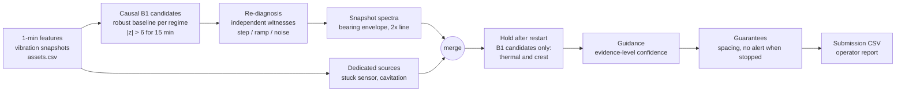

<p align="center">
  <strong><a href="https://sinceai.app/events/since-ai-hackathon-2026">Since AI Hackathon 2026</a></strong>
</p>
<p align="center">
  <a href="https://businessturku.fi/en/"></a>
  &nbsp;&nbsp;&nbsp;
  <picture>
    <source media="(prefers-color-scheme: dark)" srcset="docs/img/dodosolo_white.png">
    
  </picture>
  &nbsp;&nbsp;&nbsp;
  <a href="https://sinceai.app/"></a>
</p>

# Retrofit Assistant

**Early, explainable warnings for existing pumps: what is going wrong, whether it is the machine or the instrument, and how sure we are.**

Team DodoSolo · Since AI Hackathon 2026, challenge RETROFIT AI by Business Turku · MIT License · Python 3.14 · detector frozen at tag [`v1.0-freeze`](../../tree/v1.0-freeze) (commit `c355e31`)

**[Open the live dashboard](https://edordopng.github.io/retrofit-assistant/dashboard/)**: fleet overview and operator view for every train and validation pump. Example: [PUMP-04, flow sensor noise](https://edordopng.github.io/retrofit-assistant/dashboard/PUMP-04_20250618T2210Z.html).

## Contents

1. [Overview](#overview)
2. [Results at a glance](#results-at-a-glance)
3. [Quick start](#quick-start)
4. [Usage](#usage)
5. [How it works](#how-it-works)
6. [Results in detail](#results-in-detail)
7. [Deployment and retrofit](#deployment-and-retrofit)
8. [Reliability and safety](#reliability-and-safety)
9. [Limitations](#limitations)
10. [How we built it](#how-we-built-it)
11. [Roadmap](#roadmap)
12. [Repository layout](#repository-layout)
13. [License, attribution and team](#license-attribution-and-team)

## Overview

Ships and plants run cooling-water pumps that already produce useful signals: motor current, pressures, sometimes vibration and temperature. Today those signals mostly feed fixed-limit alarms, which fire late. On the official benchmark, the plant's existing alarm list (baseline B0) scores 23.1 out of 100 on validation.

Retrofit Assistant is an operator-assist layer on top of those signals. For each pump it:

- raises one human-reviewable alert per developing problem;
- says whether the cause looks like the **machine** or the **instrument**, using independent physically coupled channels as witnesses;
- names the likely fault type, or `UNKNOWN` when the evidence does not support one;
- attaches its evidence, an evidence-level confidence with its sample size, and guidance: what to inspect, what to do and what to rule out first.

It is meant for the person who watches the pumps and decides what to check: an operator or a maintenance technician on a ship or in a plant.

It is **advisory only**. It never writes to devices, PLCs, drives or valves and sends no control commands; existing alarms and trips stay authoritative. Every alert at time t uses only data available by t, and a truncation test enforces this.

All data are the **synthetic** pumps of the official challenge package. Results are benchmark results, not field results.

### Why rules and not a trained model

There were two broad ways to approach this challenge: train a model on the data, or encode engineering knowledge in explicit rules. We chose rules for three reasons.

- **Few labelled faults.** The training split has 26 scored events on 7 pumps, with 1 to 4 events per fault type; validation adds 9 events on 2 pumps. A classifier over 13 fault types would see very few examples of each, and a week of 1 Hz data per pump does not add independent incidents.
- **Synthetic data.** The data come from a simulator. A model trained on them would learn the simulator's patterns and would need retraining on real labelled history before use. Rules state their physics (coupled channels, NPSH margin, bearing defect frequencies) and the parameters each machine needs, so on a real pump they can be checked and adjusted one at a time.
- **Different instrumentation.** The pumps carry three tiers of sensors. Each rule switches itself off when its channels are missing, and every alert can be traced to the rule and the measurements that decided it, which is what an operator needs in order to review it.

This does not make the system immune to overfitting: thresholds were chosen on the training pumps, and the baselines are estimated from each pump's own data. It has not been tested on real equipment, and moving to a real machine means re-measuring baselines, settle times and confidence levels (see [Transfer to another rotating machine](#transfer-to-another-rotating-machine) and [Pilot plan](#pilot-plan)). A trained model becomes a reasonable option once a site has real labelled history, and the evaluation code here can score it in the same way.

## Results at a glance

Official scorer, composite score (0-100). B1 is the published baseline; `causal_b1` is our causal rebuild of B1 and the honest reference; `full` is this system.

| Detector | Train (PUMP-01..07) | Validation (PUMP-08, 09) |
| --- | --- | --- |
| B0, existing alarms (published) | 27.6 | 23.1 |
| B1 (published) | 58.2 | 78.0 |
| `causal_b1` | 58.451 | 78.013 |
| **`full`** | **78.542** | **86.107** |

On train, `full` detects 23 of 26 events against 18 for `causal_b1`, and names the correct fault type for 16 against 7, with 2 false-alert episodes against 4.

How to read these numbers:

- **The splits mix instrumentation tiers.** Train has three fully instrumented T2 pumps (PUMP-02, 04, 07), two low-cost retrofit T1 (PUMP-01, 06) and two legacy T0 (PUMP-03, 05). Validation has one T2 (PUMP-09) and one T1 (PUMP-08). Test has one of each (PUMP-12 T2, PUMP-10 T1, PUMP-11 T0). The scores are for the whole split, not for one tier; the effect of a tier on the same faults is measured in [Value of each instrumentation tier](#value-of-each-instrumentation-tier).
- **Train is in-sample.** The rules were designed and their thresholds chosen on these pumps. Validation was used to choose between variants. Only the test split, scored by the organizers, is an independent measure.
- **Validation is small.** It has 9 scored events, so one event moves the composite by several points.

## Quick start

Tested on Python 3.14 with `requirements-lock.txt`, from a clean clone:

```bash
git clone https://github.com/EdordoPng/retrofit-assistant.git
cd retrofit-assistant
python3.14 -m venv .venv && source .venv/bin/activate
python -m pip install -r requirements-lock.txt
python -m pip install -e challenge/RETROFIT_AI_PARTICIPANTS_2026 --no-build-isolation --no-deps
python -m pip install -e . --no-build-isolation --no-deps
```

Reproduce the validation score (86.1, printed with one decimal) and open the report of one pump:

```bash
D=challenge/RETROFIT_AI_PARTICIPANTS_2026/data/full
python -m retrofit_assistant predict --data $D --split validation --out build/predictions/full_validation.csv
python -m retrofit_sim score --predictions build/predictions/full_validation.csv --events $D/events_validation.csv --assets $D/assets.csv --benign $D/benign_windows_train_validation.csv --split validation
python -m retrofit_assistant report --asset PUMP-08 --data $D --predictions build/predictions/full_validation.csv --out build/report/ --until 2025-09-11T02:00:00Z
```

On a clean clone of main, installation took about 25 seconds after the download, the validation score (86.1) was reproduced, and the 38 official package tests passed.

The detector is frozen at tag `v1.0-freeze`. `main` adds only evaluation and reporting code, documentation and `submission/`; to check it, run `git diff --stat v1.0-freeze -- src/`: only `pump_table.py`, `dashboard.py`, `report.py` and the logo `assets/dodosolo_80.png` change.

On Python 3.10-3.11, install with `challenge/RETROFIT_AI_PARTICIPANTS_2026/requirements.txt` instead of the lock file; that path has not been tested.

The source-code zip uploaded with the submission excludes `challenge/RETROFIT_AI_PARTICIPANTS_2026/data` (119 MB); clone the repository to run the commands.

## Usage

Run from the repository root after `source .venv/bin/activate`, with `D=challenge/RETROFIT_AI_PARTICIPANTS_2026/data/full`. All outputs go to `build/`.

```bash
# Predictions (full is the default detector; causal_b1 is the reference)
python -m retrofit_assistant predict --data $D --split validation --out build/predictions/full_validation.csv
python -m retrofit_assistant predict --data $D --split validation --detector causal_b1 --out build/predictions/causal_b1_validation.csv

# Train and validation table with exact scores, lead time and evidence levels;
# --gate exits 0 only if full beats causal_b1
python -m retrofit_assistant compare --data $D --out build/scores/compare.md --gate

# Static HTML report for one train or validation pump; --until shows what the operator saw at that time
python -m retrofit_assistant report --asset PUMP-08 --data $D --predictions build/predictions/full_validation.csv --out build/report/ --until 2025-09-11T02:00:00Z

# Instrumentation ablation on the T2 pumps
python -m retrofit_assistant ablate --data $D --out build/scores/ablation.md

# Per-pump table (JSON and Markdown), the single source for README, slides and dashboard
python -m retrofit_assistant.pump_table --data $D --out build/scores/pump_table.json --commit $(git rev-parse --short HEAD)

# Dashboard in build/dashboard/: fleet overview (index.html) and one operator page per train or
# validation pump; uses the predictions written by compare
python -m retrofit_assistant.dashboard --table build/scores/pump_table.json --data $D --train-predictions build/predictions/full_train.csv --validation-predictions build/predictions/full_validation.csv --out build/dashboard
# A snapshot generated at commit 267a412 is published from docs/dashboard/.

# Test-split submission and format check (the check prints only PASS or FAIL with the row count)
python -m retrofit_assistant predict --data $D --split test --out build/submission/predictions_test_<UTC>_<commit>.csv
python -m retrofit_assistant check-submission --predictions build/submission/predictions_test_<UTC>_<commit>.csv --data $D --split test

# Tests: suite, complete truncation test, official package tests
python -m pytest -q tests
python -m pytest -q -m slow tests/test_causality.py
python -m pytest -q challenge/RETROFIT_AI_PARTICIPANTS_2026/tests
```

`report` and `predict --mask-tier` refuse the test split, and `ablate` runs only on train and validation pumps. `pump_table` and `dashboard` score and show only train and validation pumps; the test pumps appear with their tier only.

## How it works

The `full` detector is a chain of causal rules. Each alert carries an internal record of the rule that decided it; that record never reaches the CSV.



The diagram shows the order of execution in `pipeline.py`; the list below describes each rule.

1. **Causal B1 candidates.** Per channel, a robust baseline (median and MAD per operating regime) is computed on steady minutes already available, refreshed every hour and frozen at t0 + 24 h. A channel alerts when |z| > 6 for 15 consecutive steady minutes, or on missing rows or a flat signal. Below 30 steady minutes there is no z-score, so there are no B1 alerts in the first hour.
2. **Re-diagnosis at the alert time** (class, type, evidence and action only, never which alerts exist or when):
    - *Independent witnesses.* For the deviating channel, the physically coupled channels that are installed and fresh act as witnesses. The actuators (speed, valve position) never act as witnesses, and suction pressure is not a witness for discharge pressure or flow.
    - *Confirmed* (at least two witnesses fresh and still): instrument fault, typed by shape: a persistent step gives calibration shift, a ramp of at least 2 h gives drift, persistent isolated variance gives noise spikes.
    - *Refuted* (a witness follows the deviation): a sensor alert becomes MACHINE / UNKNOWN.
    - *Not verifiable*: the official diagnosis stays.
3. **Dedicated sources** for faults B1 cannot see:
    - *Stuck sensor*: the same value for at least 16 real updates, counted on updates, not minutes (wireless channels update every 300 s).
    - *Cavitation*: NPSH available from measured suction pressure and vapour pressure at fluid temperature, compared with the nameplate NPSH3 in `assets.csv`; below a 1.15 margin for 5 minutes while running.
4. **Snapshot spectra** for alerts that are still MACHINE: an envelope peak at the bearing defect frequency (BPFO or BPFI from `assets.csv`) at least 6 times the band noise gives bearing wear; a 2x line at least doubled after a maintenance lockout gives misalignment. Only snapshots of the same pump, available by the alert time and at most 8 h old, are used.
5. **Hold after restart.** If, right after a restart, the only channels sustained above threshold are the winding temperature, the bearing temperature or the crest factor, the alert is held for 120 minutes and emitted only if the deviation is still there. This removes thermal warm-up false alerts after maintenance. Only the alert time changes; the diagnosis is made at the original time. Alerts from the dedicated sources are not held.
6. **Guidance.** Each alert gets a deterministic "Inspect / Do / Rule out first" text tied to the rule that decided it. Sensor alerts say to verify the instrument before opening the pump.
7. **Evidence-level confidence.** Each rule belongs to a level (high, medium, low). The CSV confidence is the level's fault-type reliability on train, estimated as (hits + 1) / (n + 2) (Laplace): high 0.938, medium 0.618, low 0.200. Validation is a check only. The report card shows both reliabilities, alert and type, with n.
8. **Guarantees.** At least 6 minutes between alerts on one pump, no alert while stopped or locked out, an emitted alert is never revised.

Every rule switches itself off when the channels it needs are not installed on that pump, so the same pipeline runs on T0, T1 and T2.

The operator report is a static HTML page per pump, with no server and no external resources. It shows a timeline with alert markers and one card per alert, with the previous alerts on the same pump within 12 h. When the class or type changes it says so: on PUMP-07 (train) a flow deviation first reported as MACHINE / DISCHARGE_RESTRICTION is later shown as "Diagnosis changed from MACHINE/DISCHARGE_RESTRICTION" when the witnesses confirm a calibration shift.

## Results in detail

### Detection by split

| Detector | Split | Events detected | Fault type correct | Class correct | False-alert episodes | Excess repeats |
| --- | --- | --- | --- | --- | --- | --- |
| `full` | train | 23 / 26 | 16 | 21 | 2 | 2 |
| `full` | validation | 9 / 9 | 6 | 9 | 0 | 1 |
| `causal_b1` | train | 18 / 26 | 7 | 15 | 4 | 3 |
| `causal_b1` | validation | 8 / 9 | 4 | 8 | 1 | 0 |

### Detection by pump

| pump | split | tier | scored events | detected | type correct | class correct | false-alert episodes | excess repeats |
| --- | --- | --- | --- | --- | --- | --- | --- | --- |
| PUMP-01 | train | T1 | 4 | 4 | 3 | 3 | 0 | 0 |
| PUMP-02 | train | T2 | 3 | 3 | 1 | 3 | 1 | 0 |
| PUMP-03 | train | T0 | 3 | 3 | 2 | 3 | 0 | 0 |
| PUMP-04 | train | T2 | 4 | 3 | 3 | 3 | 0 | 1 |
| PUMP-05 | train | T0 | 2 | 1 | 1 | 1 | 0 | 0 |
| PUMP-06 | train | T1 | 7 | 6 | 6 | 6 | 1 | 0 |
| PUMP-07 | train | T2 | 3 | 3 | 0 | 2 | 0 | 1 |
| PUMP-08 | validation | T1 | 4 | 4 | 3 | 4 | 0 | 0 |
| PUMP-09 | validation | T2 | 5 | 5 | 3 | 5 | 0 | 1 |
| PUMP-10 | test | T1 | labels held by organizers, not scored |  |  |  |  |  |
| PUMP-11 | test | T0 | labels held by organizers, not scored |  |  |  |  |  |
| PUMP-12 | test | T2 | labels held by organizers, not scored |  |  |  |  |  |
| **train total** | train | mixed | 26 | 23 | 16 | 21 | 2 | 2 |
| **validation total** | validation | mixed | 9 | 9 | 6 | 9 | 0 | 1 |

Official scorer applied to one pump at a time; the split totals are the official split scores. Generated by `pump_table.py` (`build/scores/pump_table.md`); the same JSON feeds the slides and the dashboard.

Counts per pump are not comparable across tiers: each pump has different faults. The effect of the tier on the same faults is in the next section.

### Value of each instrumentation tier

The T2 pumps (PUMP-02, 04, 07 on train; PUMP-09 on validation) were re-run with the channels a T1 or T0 installation would not have.

| Instrumentation | Split | Composite | Events detected | Fault type correct |
| --- | --- | --- | --- | --- |
| T2 (as installed) | train | 70.918 | 9 / 10 | 4 |
| T1, simulated | train | 56.964 | 6 / 10 | 3 |
| T0, simulated | train | 45.606 | 5 / 10 | 0 |
| T2 (as installed) | validation | 82.504 | 5 / 5 | 3 |
| T1, simulated | validation | 82.471 | 5 / 5 | 3 |
| T0, simulated | validation | 44.967 | 2 / 5 | 1 |

On train, the simulated T1 detects 6 of 10 events instead of 9. One of these losses comes from the hold after restart (7 detections without it): PUMP-07-E02, a calibration shift of the flow sensor, is invisible once the flowmeter is masked, and without the hold it was matched only through a bearing-temperature transient after a restart. The hold removes that spurious match. On the validation pump, T1 loses almost nothing. Moving to T0 halves the detections and leaves almost no correct fault type.

The simulated T1 is optimistic, because the 300 s wireless cadence is not emulated; masked scores are pessimistic, because the events' `observable` flags come from the real T2 instruments.

### Evidence levels (train fit, validation check)

| Split | Level | Alert hits / n | Alert reliability | Type hits / n | Type reliability |
| --- | --- | --- | --- | --- | --- |
| train | high | 14 / 14 | 0.938 | 14 / 14 | 0.938 |
| train | medium | 31 / 32 | 0.941 | 20 / 32 | 0.618 |
| train | low | 2 / 3 | 0.600 | 0 / 3 | 0.200 |
| validation | high | 6 / 6 | 0.875 | 6 / 6 | 0.875 |
| validation | medium | 9 / 9 | 0.909 | 4 / 9 | 0.455 |
| validation | low | 0 / 0 | - | 0 / 0 | - |

The CSV uses the type reliability because, at these sample sizes, alert reliability does not separate the levels. These are observed hit rates with small n, not calibrated probabilities.

### Lead time

The median lead to the action deadline is 8.29 h on validation for both `full` and `causal_b1`. On train it is −0.20 h for `full` against 55.79 h for `causal_b1`. The median is taken only over detected events that have a deadline, and `full` adds three cavitation events whose deadlines are minutes after onset, where our alert arrives 2-13 minutes late; those events pull the median down. Do not quote the train lead time without this explanation.

### Test submission

The final test-split submission is [`submission/predictions_test_20261107T174152Z_c355e31.csv`](submission/predictions_test_20261107T174152Z_c355e31.csv), 30 rows, sha256 `037a75bd03c9d509398ba397b92903d8f28d336af00a68f91361ad1882ed8d98`, generated at tag `v1.0-freeze`. Before the freeze it was checked for format only.

## Deployment and retrofit

### What each tier adds, and what it costs

Hardware prices are reference values from the challenge package (`RETROFIT_FEASIBILITY.md`, public list prices seen on 30 Oct 2026, or the package's own assumptions where no public price exists). They are not quotes, and they exclude cabling, enclosure, installation and class or flag approvals. Detection figures are our ablation on the T2 train pumps (same 10 faults, channels removed).

| Tier | Adds | Detected / correct type (T2 train pumps, simulated tier) | Reference hardware cost |
| --- | --- | --- | --- |
| T0, existing signals | motor current, discharge pressure; speed and power if a drive exists | 5 / 10 events, 0 correct types | no new sensor; an edge computer, EUR 497-602 |
| T1, low-cost retrofit | suction pressure transmitter; wireless vibration and temperature on the bearing housing | 6 / 10 events, 3 correct types | pressure transmitter about EUR 145 (EUR 288 class-approved for ships); wireless vibration EUR 300-1,500 per point plus a gateway of EUR 1-3 k (package assumption) |
| T2, full | wired vibration at 1 s, power meter, flow meter, winding PT100, valve feedback | 9 / 10 events, 4 correct types | wired minimum package without flow: EUR 2.1-2.4 k (Modbus) or EUR 2.8-3.1 k (IO-Link); flow EUR 0.2-0.4 k indicative or EUR 3-10 k instrument grade |

What the table says: on these pumps, the step from T0 to T1 is what makes fault types nameable, and T2 adds most of the remaining detections. On the validation pump, T1 loses almost nothing against T2. In the package's own business example the case depends mostly on the cost of downtime and on a low false-alert rate; a redundant pump with a healthy standby rarely justifies new sensors.

### Running at the edge

Measured on a laptop, not on an edge box: one pump's 7-day window is processed in **3.76 s** (PUMP-07, train) and **3.07 s** (PUMP-08, validation), with a peak memory of **417 MiB** and **412 MiB**. Each figure is the median of 3 runs, each in a fresh process, including start-up and data loading (AMD Ryzen 5 PRO 4650U, 6 cores, 14 GiB RAM, Python 3.14; another process was running at the same time). We have not run it on edge hardware.

Done today: a batch CLI, a static HTML report and dashboard with no server and no external resources, and a design that only reads data. Proposed for a site: read-only access to existing signals (historian export, OPC UA read nodes or Modbus read registers), detection on an edge box in its own network zone with local buffering, and advisory alerts sent out through a one-way conduit. Existing alarms, trips and safety systems stay authoritative and untouched. On vessels contracted from 1 July 2024, IACS UR E26/E27 apply to such a connection.

### Transfer to another rotating machine

Example: a motor-driven fan on the same site.

| Component | Transfers as is | Must be reconfigured | Limit |
| --- | --- | --- | --- |
| Causal baseline and B1 candidates | robust per-channel z by operating regime | the regime definition (speed or load bands) | about 24 h of steady running to build the baseline; no z in the first hour |
| Sensor versus machine (witnesses) | the confirmed / refuted / not verifiable logic | the map of physically coupled channels (for a fan: current, airflow, differential pressure, vibration) | needs at least two independent installed witnesses |
| Stuck-sensor source | the rule, counted on real updates | each channel's update interval | - |
| Cavitation source | does not transfer: it is pump physics | - | a fan needs its own physics rule (for example stall or surge), not built |
| Snapshot spectra | bearing envelope and 2x after a lockout | bearing defect orders from the nameplate | needs vibration snapshots with speed at capture |
| Hold after restart | the rule | settle time and thermal channels | settle time must be measured on the new machine |
| Guidance | the "Inspect / Do / Rule out first" structure | the text for each fault type | to be reviewed by a maintenance engineer |
| Evidence-level confidence | the method | the hit rates, re-estimated on the new machine's labelled history | small n at the start |
| Report and dashboard | everything | channel names and units | - |

### Pilot plan

1. **Read-only data, 4-8 weeks.** Connect to existing signals on one pump and build the per-regime baselines. No alert reaches an operator.
2. **Shadow mode.** Alerts are logged and compared afterwards with operator logs, alarms and work orders. Measure precision, lead time and false alerts per pump-week against what the operators actually decided.
3. **One retrofit point** where shadow mode shows a blind spot, for example wireless vibration on a critical pump without redundancy.
4. **Advisory pilot.** Alerts go to a named role with the evidence view; operators record whether each alert was useful, and how a false alert is closed is agreed beforehand.
5. **Review.** Scale up only on measured value (avoided stops and repairs, minus the cost of false alerts), after an independent engineering and regulatory review.

## Reliability and safety

- **Advisory only.** No code path writes to a device, PLC, drive or valve; a test scans the package imports for network, fieldbus and device-write modules. Every recommendation is an inspection or a check for a person to approve.
- **Causality.** For every pump of train and validation, the pipeline is re-run on input cut at many points (random, around minute boundaries, at every alert and every held emission). Alerts up to the cut must equal those of the full run in every column. A fast version runs with the suite; the complete version (`-m slow`) ran before every commit that touched detection. Each rule change was also checked with a look-ahead mutation that the test had to catch. At the freeze, the truncation test also passed on the test pumps, reported as pass or fail only.
- **Runtime inputs.** One loader reads every runtime file with an availability rule, joins only backward in time, and never reads events, benign windows or in-window maintenance; a test enforces this.
- **Determinism.** The official baseline diagnosis iterates a set, so its output depends on the process hash seed. Our CLI re-executes itself with `PYTHONHASHSEED=0`, and a test requires byte-identical CSVs from processes started with different seeds. Our own rules use fixed channel orders.
- **Golden reference.** The CLI output of `causal_b1` is frozen by sha256. The test runs only on the environment of `requirements-lock.txt` and skips explicitly, with a reason, on other Python minor or pandas, numpy and pyarrow versions.
- **Test-split integrity.** The test pumps (PUMP-10..12) were never used for tuning, thresholds or inspection. Their output was only checked for format, and the submitted detector is the one at tag `v1.0-freeze`.
- **Honest uncertainty.** `UNKNOWN` is used when the evidence does not support a type; confidence is an evidence level with its sample size; a sensor fault is declared only with at least two independent witnesses.

## Limitations

- **Simulator.** The rules use the same physics as the generator (NPSH, coupled channels, vibration terms), so the measured gains overstate field performance.
- **Fault types.** AIR_ENTRAINMENT is not named by any rule. IMBALANCE is named only by the official rules. When bearing wear and imbalance overlap on one pump, the bearing precedence of the spectra overwrites imbalance alerts that were correct.
- **Cavitation.** One physical context on train (n = 1 pump). The 1.15 margin is an assumption; our NPSH estimate has no velocity head without a flow meter and no flow dependence of NPSH3, and real equipment needs a site check of the margin. On PUMP-06 the margin is thin outside events. Alerts arrive 2-13 minutes after the action deadline.
- **Sensor versus machine.** At least two independent witnesses are needed to declare a sensor fault, a design choice that was not measured. On T0 and on T1 without a drive, a discharge-pressure deviation can therefore no longer be confirmed as a sensor fault.
- **Restart hold.** Fewer false alerts after maintenance, at the cost of up to 2 h of delay on alerts driven only by thermal or crest channels; validation mean timeliness falls from 0.932 to 0.832. The hold never activated on the real T1 and T0 pumps: not on PUMP-01, 03, 05 and 06 (train), and not on PUMP-08 (validation), where 0 of 6 candidates were held. Its effect on those tiers is therefore not demonstrated either way.
- **Warm-up.** No z-scores in the first hour of each pump's window.
- **Confidence.** The low level has n = 3 on train; the report infers the level from the confidence value, because the CSV does not carry the rule.
- **Scorer matching.** A change of fault type can move an alert onto another event, so part of the validation gains of the re-diagnosis and of the spectra comes from matching, not from a better diagnosis. On validation, single events drive the differences.

## How we built it

**Method.** The direction was fixed in an architecture decision record before any code (`docs/decisions/0001-mvp-direction.md`), then turned into a specification with acceptance criteria (`docs/specs/mvp.md`). Every later change of plan is recorded, with its reason and its measurement, under "Changes after approval" in the specification and in the ADR amendments.

Four rules held throughout:

- **Measure before keeping.** Every variant was scored with the official scorer on train and validation, with the acceptance criterion fixed before the measurement. A change was kept only if it scored at least as well as `causal_b1` on both splits and better on at least one.
- **Causality first.** The truncation test was written alongside the causal core, before any new rule, and every rule that touched detection had to pass it.
- **A valid submission at all times.** A test CSV was regenerated and format-checked at each milestone, so a working submission existed from the first morning.
- **Freeze.** Detection was frozen at `v1.0-freeze`; after the tag only documentation, the report and evaluation modules changed.

**What we tried and rejected.**

| Variant | Measured result | Decision |
| --- | --- | --- |
| One alert per channel family instead of reminders | train 56.74, validation 72.39; detections lost (17 / 26, 7 / 9) | rejected |
| Proportional witness rule (follow ratio 0.25) | turned 3 correct train alerts wrong | rejected |
| Warm-up limits in the first 24 h | 1 false-alert episode in the first 24 h, below the threshold of 3 | not needed |
| Watch state before emitting (hold 1-12 h) | lost 2.7-7.5 points and 1-3 detections on train | cut |
| Rotating-fault rules on 1-minute features (crest, velocity step after lockout) | no train gain; the validation gain came from one event | rejected |
| AIR_ENTRAINMENT rule | the expected cause (heavy weather) was absent at the train event: median wave height 0.2 m | not written |
| Pump-curve residual in re-diagnosis | at most 1 train type to gain, 3-4 correct alerts at risk | not built |
| Suppress repeats for 12 h by channel or by class | train 65.099 and 68.220, with 5 and 4 detections lost | rejected |
| Restart hold on the largest-\|z\| channel | held a sensor alert on discharge pressure because of a thermal channel | rejected |
| Restart hold on the re-diagnosis channel | +0.57 on train, within noise; thermal channels are not used by re-diagnosis in the first 120 min | rejected |
| Restart hold on every channel | delayed true faults by days and lost one validation detection | rejected |

**Tools.** The product contains no generative AI: detection and diagnosis are deterministic rules. Development used AI assistants under fixed working rules (`AGENTS.md`). Claude Code acted as supervisor: it wrote the specification and closed briefs, and verified each change with the suite, the complete truncation test and look-ahead mutations. OpenAI Codex implemented each brief in its own git worktree. A second model reviewed the diagnosis design, with access to train data only. No commit was made without the author's approval.

## Roadmap

- Pump-curve and affinity checks, and an absolute pressure check for T0.
- CUSUM or slope detectors on normalised residuals, for slow faults.
- A witness rule where suction pressure can refute but not confirm a discharge or flow sensor fault.
- Exclude out-of-range minutes in the re-diagnosis: a saturated witness can look still.
- Write the evidence level to an output column instead of inferring it from the confidence value.
- A read-only OPC UA or MQTT adapter, and a natural-language explanation of the report.
- A pilot on a real pump: read-only data first, then shadow mode, comparing alerts with operator logs, alarms and work orders.

## Repository layout

```
src/retrofit_assistant/   our package
  runtime: data, baseline, detectors, consistency, diagnosis, sources, spectra, hold,
           recommendations, confidence, policy, params, pipeline, output, cli
  development only: evaluate, ablation, report, pump_table, dashboard
tests/                    suite, truncation test, boundaries and golden tests
docs/decisions/           architecture decision records
docs/specs/               specification with acceptance criteria and changes after approval
docs/dashboard/           dashboard snapshot published on GitHub Pages
docs/img/                 logos
submission/               final test-split predictions
challenge/RETROFIT_AI_PARTICIPANTS_2026/   official challenge package, unmodified (read-only)
build/                    generated outputs (not tracked)
```

## License, attribution and team

Our code is under the MIT License (`LICENSE`). `challenge/RETROFIT_AI_PARTICIPANTS_2026/` is the official challenge package, included unmodified, under its own licenses: MIT for code, CC BY 4.0 for data. See `ATTRIBUTION.md`.

The Business Turku and Since AI logos are trademarks of their owners, shown only to identify the challenge and the event; no endorsement is implied.

Team **DodoSolo**: Edoardo Diana. Built for the Since AI Hackathon 2026 (Turku, 6-8 November 2026), challenge RETROFIT AI by Business Turku.
